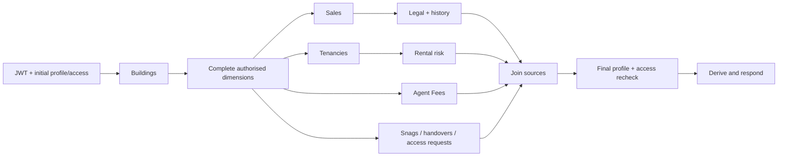

# Stage 2 dashboard server performance

Based on staging `1562549` (PR #45), 12 October 2026. Target: `staging`. No UI, model, workflow, SQL, schema, RLS, region or production-configuration changes.

## Result and limits

The dependency change removes the measured source barrier, but **a repeatable end-to-end latency improvement is not established**. The first comparison reduced median local-handler latency against live staging Supabase by 4–5%: 1,522 → 1,451 ms for all buildings, and 1,512 → 1,449 ms for Forum House. Eight of ten paired requests improved in each scope. The all-building worst sample did not improve (1,925 → 1,958 ms); this is a modest scheduling gain, not a demonstrated tail-latency fix.

A second, independent ten-pair batch did not repeat the latency gain: all-building medians were **1,566 → 1,590 ms** and single-building medians **1,527 → 1,593 ms**. Only 4/10 and 3/10 pairs improved. The Sales-history dependency wait still fell **24.51 → 0.62 ms** and **31.77 → 0.58 ms**. Complete authorised snapshots (including items omitted from Stage 1 transport) matched in all 20 confirmation pairs; their hashing/extra derivation occurs outside the timer. Network/service variability and changed overlap outweigh this small saving in some runs. Keep this PR in draft pending comparable deployed evidence; the success criteria are not yet met.

These are real database/network measurements from a local Node process, **not simulated delays and not deployed Vercel latency**. The deployed staging baseline remains slower: median 3,166 ms all buildings, 2,783 ms single building. No deployed before/after conclusion or consistent sub-two-second claim is established by the local results.

## Method

Before editing runtime code, captured five local and five deployed samples per scope and ran 58 unchanged dashboard tests. Then compared the original reader from Git with the edited reader in the same process, same admin JWT, same database and scopes; ten pairs per scope, alternating variant order, sequential API requests. Actual route authentication, initial/final profile and access validation, database reads and response composition execute in both variants. No service-role reads or workflow mutations. The original reader uses unchanged helper dependencies and the same diagnostic observer as the new reader.

The deployed baseline is `https://staging.bunnywell.co.uk`, verified as commit `1562549b0c4aa609f8ae205f190d8ddf34e1a8aa`, deployment `dpl_JCtDrHaJuUKNi568EkegmekrMpsc`. Its Server-Timing headers work but its opt-in per-read trace is absent. Detailed operation attribution below is therefore **local**, not proof of which deployed query dominates. The local harness explicitly enables the existing preview observer only inside its staging-validated process; it changes no deployment flags.

All response hashes matched within each scope, after normalising `asOf` and source-status array ordering. No other payload values or item ordering are normalised. Source statuses now retain declaration order instead of network completion order. Payload sizes and call counts match exactly. Evidence contains timing metadata and hashes, not records, credentials, URLs with query values or error bodies.

Sample sizes of five and ten do not support a stable p95, so report median and worst. First requests are retained in raw evidence but are not proven cold function starts. Later requests are process-warm; upstream cache warmth is uncontrolled. Browser time to usable dashboard is not measured for this server comparison: existing browser tests intercept API responses and cannot establish that improvement.

## Critical path and bottlenecks



Previously, L, R and F all waited for **S + T + O**. They now wait only for their own prerequisites. Common dimensions and all security gates are unchanged. A per-request FIFO semaphore caps actual reads, including response consumption, at **nine** (the previous second-wave maximum). Pages and 150-ID batches remain sequential within each source. Request count does not increase.

Ranked findings from ten baseline all-building local traces:

1. **Sales workflow context**: median 794 ms RTT, upstream header 617 ms, 327,800 response bytes and 20 ms body consumption. This finishes last among data reads. The upstream header is not pure SQL time; network/service/serialization components cannot be fully separated without a deployed trace and database plan. The scalar JSON RPC already selects latest events per sale/type; replacing it with a seven-row activity query would break stage context and authority calculations. Retained.
2. **Unnecessary dependency wait**: Sales-history median wait after Sales completes fell 45.21 → 1.53 ms (all) and 59.50 → 0.60 ms (single). Earlier Fees and rental-risk reads overlap unrelated sources. This is the implemented, measured opportunity.
3. **Actor names and legal documents**: 383 ms / 343 ms median RTT, upstream 283 / 256 ms; they overlap history and are not the final barrier in these samples. The actor RPC retains historical actor access semantics. Document reads retain current, visible, unsuperseded versions and exact completeness.
4. **Authentication/access network rounds**: still serial at the required initial/final boundaries. Individual access reads mostly show 2–6 ms upstream versus 60–90 ms RTT locally. Their repeated reads detect revocation and must remain. The extra deployed delay cannot be assigned solely to networking from aggregate headers.
5. **Application processing**: final derivation median 22 ms (18 ms single); body consumption mostly below 1 ms except history. Repeated model iteration is not the primary bottleneck; no model rewrite justified.

[Complete 27-call inventory with start, finish, RTT, upstream, body and bytes](calls.md). The 27 excludes the authentication request; single-building requests have 26 database calls because this fixture has no tenancy IDs to query for arrears. No paging, retries or repeated ID batches occurred in these live samples. Larger synthetic fixtures verify existing paging and bounds.

## Before / after

Medians, milliseconds unless specified. Local A/B: ten observations per cell. Deployed baseline: five per scope. Supplied HAR is a separate observation, not paired with this change.

| Metric | Supplied staging HAR | Local all: before | Local all: after | Local single: before | Local single: after |
|---|---:|---:|---:|---:|---:|
| API/handler harness elapsed | 3,518 | 1,522 | 1,451 | 1,512 | 1,449 |
| Last database-read offset, including final access | 3,320 | 1,501 | 1,424 | 1,492 | 1,431 |
| Data-source phase wall time | Unknown | 1,157 | 1,082 | 1,126 | 1,045 |
| Data-source completion offset, before final rechecks | Unknown | 1,380 | 1,282 | 1,350 | 1,263 |
| Summed overlapping DB fetch durations | Unknown | 4,081 | 3,915 | 3,825 | 3,618 |
| Database calls, excluding auth | 27 | 27 | 27 | 26 | 26 |
| JSON bytes | Approximately 15.8 KB | 15,942 | 15,942 | 15,808 | 15,808 |
| Worst elapsed | Unknown | 1,925 | 1,958 | 2,035 | 1,725 |

Summed fetch time is Server-Timing's cumulative remote fetch duration to headers. It is **not elapsed wall time or SQL time**. Per-call RTT through SDK consumption appears separately in the inventory. The data-source phase is measured between `data` and `profile.final`; the full response also requires initial/final access gates and derivation. There is no single operation whose duration equals the entire critical path.

## Database-work review and remaining opportunities

- The fee RPC returns 62 eligible attempts / 36,546 bytes for both scopes before application filtering. It costs about 187 ms locally and is not the final barrier. Filtering to current active dashboard sales would lose historical invoices. Filtering returned table rows would also change the current full-portfolio validation contract, and may not reduce work inside its PL/pgSQL body. Keep the canonical query and full metadata validation until a separate measured change proves equivalent eligibility, failure handling and benefit.
- Sales/history/legal/arrears reads are already scoped by authorised building or related IDs. Rental imports are scoped by building, and still load when there are no tenancy IDs so missing/import-failure evidence is preserved. Handovers query only completed scoped units. Snags keep the Stage 1 current-state/latest-transition projection.
- Building and organisation dimensions support scope/navigation, appointment ownership and complete fee validation. Resident requests retain their existing RLS-filtered pending query. No proven removable read was found without changing source semantics.
- Next investigation: obtain guarded **deployed** per-read traces and a read-only execution plan for `sale_workflow_context`, with the same role and sales IDs, before proposing SQL/index changes. Investigate repeated event projection/access checks and response volume separately. Any database proposal needs its own evidence, rollout and rollback plan. No database change is included here.

## Validation

- Dashboard suite: 97 passed before the final two focused additions; all 13 scheduling/diagnostic tests pass including the additions (99 distinct dashboard tests validated).
- Sales: 308 passed. Fees: 99 passed. Sales refresh: 55 passed. Existing SQL/access fixtures are included in those suites.
- Rentals: 57 passed; one existing regex assertion fails (`Agent Fees applies the shared global building scope`). Both its test and the component are unchanged from staging; Stage 1 documents the same failure.
- Browser dashboard/Sales suite: 38 passed, two opt-in benchmarks skipped; one polling case failed during navigation. It passed in an isolated baseline run and again with the optimized reader (39 distinct cases passed).
- Browser Agent Fees: 15 passed, two opt-in captures skipped; three failed initially (focus/navigation/refresh timing). Two passed on targeted rerun; the remaining mobile case passed with the baseline and optimized reader in isolation (18 distinct cases passed). No production UI or test expectations were changed to make these pass.
- TypeScript and changed-file ESLint pass without errors or warnings. No UI/component changes.
- Focused tests cover slow/failed requests, rejected promises, partial legal/history/rental failures, inaccessible scope, failed dimensions, profile/building revocation during loading, all supported roles, historical/unallocated fees, deterministic complete snapshots, the nine-read ceiling, paging and Sales-register mode.

## Reproduction

From the worktree, provide the existing staging reviewer credentials in an ignored environment file. No credentials belong in committed evidence.

```powershell
$env:STAGE2_ENV_FILE='.env.local'
$env:STAGE2_STAGING='1'
$env:STAGE2_OUTPUT='test-results/dashboard-stage2/new-paired.json'
$env:STAGE2_BASELINE='1562549'
$env:STAGE2_ROUNDS='10'
node scripts/diagnostics/dashboard-stage2.mjs
```

For the unchanged deployed baseline, omit `STAGE2_BASELINE`, set `STAGE2_ORIGIN=https://staging.bunnywell.co.uk`, use a new output filename and five rounds. The harness refuses other backends, unsupported origins, unavailable source snapshots and overwritten evidence. It stops on a response over ten seconds or changed authorised results. Extra complete-snapshot comparison runs after the latency timer stops.

Raw safe evidence: [pre-edit local baseline](local-before.json), [deployed baseline](deployed-before.json), [paired local runs](local-paired.json), [independent confirmation](local-confirmation.json), [summary](measurements.json). Revert the reader change to roll back scheduling; no data migration or shared cache is involved. Do not merge or deploy to production as part of this task.
