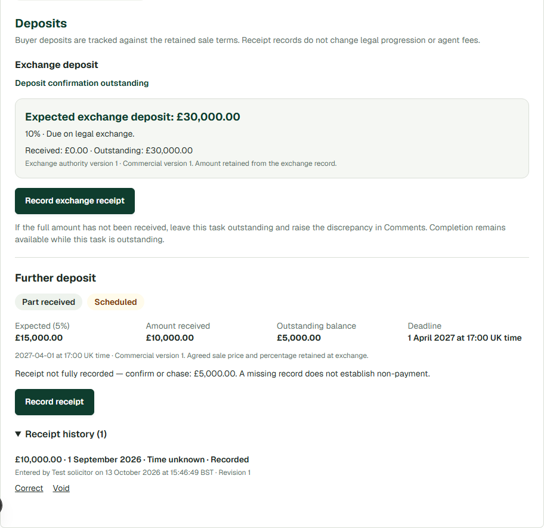
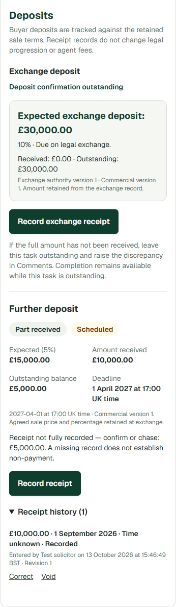
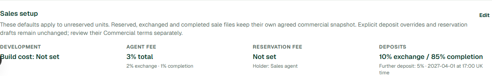

# Further deposits and Financials receipt management

This change adds optional further deposits to building defaults and sale terms, with calendar months after legal exchange, calendar months before target PC, or a fixed UK date/time. Financials has a compact Deposits / Agent fees selector. Exchange retains a receipt summary and Manage deposits link; its legal stage remains complete after exchange. Completion documents and approval gates are unchanged.

## Configuration and retained terms

- Configure the percentage and timing under building Sales setup. New fixed settings require a date and time in Europe/London. The stored value includes the local date/time and resolved UTC instant. Missing and repeated DST hours are rejected for explicit review.
- Calendar offsets clamp month ends. Empty offsets remain missing, never zero. A missing or month-only anchor produces Needs confirmation. A PC-derived date is explicitly a forecast until an authorised developer/admin records an audited sale-specific deadline.
- Defaults update existing unreserved baseline terms in the same database transaction. The trigger locks matching sale attempts, units and terms; excludes buyer/reservation drafts, approved/reserved/exchanged/completed files, differing deposit terms, and explicit schedule amounts/notes. It does not create sale attempts.
- Existing data has no dedicated deposit-inheritance marker. Equality with the previous deposit defaults, an untouched draft and an ordinary schedule identify inherited settings. A differing package is preserved and called out in the unit's Commercial summary. An override identical to old defaults is not distinguishable from inheritance in legacy data.
- Deposit-only default changes do not recascade agent fees. The original fee cascade still runs when those fee/reservation settings are edited.
- New unreserved units read the current defaults when commercial terms are first created. Reserved and later files keep the existing terms/approval lifecycle. The existing immutable exchange source retains the further-deposit rule and terms version; later asking prices, defaults and PC dates cannot rewrite that source.
- Explicit retained further-deposit schedule amounts take precedence over price × percentage. Reservation fees are not subtracted again. Completion percentage is only the scheduled remainder, not a completion statement.
- Disabling a default affects eligible future/baseline terms only. No source, obligation or receipt history is deleted.

## Receipts, access and actions

The original exchange source, receipt table, full-amount confirmation, correction history and legal endpoint are reused. No exchange receipt data migration is performed. A disposable-database test creates an exchange receipt and correction before this migration and compares every retained source/receipt row afterwards.

Further receipts and deadline amendments reference that same retained source and the particular sale attempt. Further receipts allow positive GBP amounts, date, optional actual UK time and a note. Recorded-at/user/organisation are separate audit facts. Corrections and voids append revisions with a reason; records cannot be edited or deleted through the app roles.

The authenticated RPC checks existing building access, actor identity, active exchanged sale, retained source and the building-appointed conveyancer organisation. Only that conveyancer organisation records/corrects/voids receipts. Developers/admins monitor receipts and may confirm/amend contractual deadlines with a reason, but cannot record purchaser money. RLS protects reads across buildings. Completed active files allow reconciliation; inactive attempts retain read-only history.

The RPC serialises on the sale attempt, enforces a request ID and the balance seen by the form, and rejects stale corrections. Identical retries return the original record. Overpayments require acknowledgement and show a separate excess; the obligation is never silently increased or truncated.

Financials and Dashboard/Sales use the same compact deposit projection and timing calculation. There is no task ledger. Payment progress and timing are separate. Confirmed outstanding balances become Upcoming within 30 calendar days, Due today before a known cutoff, and Overdue at the exact cutoff instant. Date-only obligations expire after the UK calendar day. Date-only receipts do not establish whether a timed deadline was met. Forecasts, incomplete terms and deadlines before exchange require review.

Full receipt removes collection work; corrections can restore it. Unreserved/unexchanged, inactive and withdrawn attempts do not generate further-deposit collection actions. Completed sales show reconciliation without an overdue deadline. Ownership remains the appointed building conveyancer, or Unallocated. Deposit links open Financials > Deposits, and existing fee links/bookmarks open Agent fees.

Reads are bounded batches over authorised sales. Receipt saves refresh the affected sale and action counts, preserve the Financials subview, and keep failed input available. The existing 30-second clock updates timing. No outbound reminders were added.

## Rollout order

1. Review and apply `20261013141431_further_deposit_configuration_and_receipts.sql` through the normal authorised migration process after all existing staging migrations. It adds columns, append-only tables, the compact view, validation/default-inheritance triggers and secured RPCs. It also wraps the existing commercial save and legal snapshot routines.
2. Deploy the application after the migration: the new read paths require the view/RPCs. Refresh existing browser sessions.
3. Perform the synthetic staging checks below, then let the user configure the actual building.

This work did **not** apply a migration to shared staging/production, deploy, alter real buildings/sales, or send emails. Do not drop the new history tables to roll back an application release. Pause further-deposit/default editing if reverting to an older app that cannot display the retained configuration.

## Verification (13 October 2026)

| Check | Result |
| --- | --- |
| `npm run test:sales` | 308 passed |
| `npm run test:sales-deposits` | 13 passed |
| `npm run test:dashboard` | 86 passed |
| `npm run test:sales-refresh` | 55 passed |
| `playwright test --config playwright.deposits.config.ts` | 7 passed |
| `tsc --noEmit --incremental false` | Passed |
| `next build --webpack`, synthetic public Supabase environment | Passed |
| ESLint on new application modules | Passed |
| ESLint on changed existing files, compared with staging `40f4259` | Same 15 errors and 20 warnings as staging; no added rule findings |
| `git diff --check` | Passed |

The known lint baseline is 13 errors/20 warnings in ProductionPortalApp and two existing effect errors in SalesReservationWorkflow. It is outside this feature's scope.

The 13 deposit tests include real disposable PGlite SQL execution, RLS/role and actor-spoof checks, preserved old exchange receipts, multiple receipts/retries/stale writes, correction/void history, explicit credits, penny rounding, future date/time rejection, excess, month ends/leap years, DST, date-only amendments, fixed/forecast rules, defaults and snapshots, completion gates, actions and deep links. Browser tests exercise the actual deposit SQL through synthetic transport, commercial API validation, failed-save recovery, saved defaults, selected views, existing fee editor behaviour and responsive layout.

Not run: shared staging acceptance, a full historical migration replay against a live project, and a true multi-connection PostgreSQL race. PGlite queues parallel requests in one engine; tests cover duplicate replay/stale balances, while the production SQL uses a sale-row lock and uniqueness constraints. The browser's Supabase/auth/network traffic is synthetic, so hosted PostgREST integration still belongs in staging acceptance.

### Manual staging acceptance after authorised rollout

1. Configure a synthetic building with 10% exchange and 5% further deposit, fixed at 1 April 2027, 17:00 UK. Check an existing unreserved baseline, an explicit override and a newly created unit; confirm fees and reserved snapshots are unchanged.
2. Progress a synthetic £300,000 sale through the usual commercial approval and exchange flow. Check the retained £15,000 further obligation and unchanged Exchange completion.
3. Record £10,000 and £5,000 with the appointed conveyancer. Check Financials, Dashboard and Sales balances/actions after each. Correct/void with a reason and verify the restored balance and history.
4. Change target PC: the fixed deadline must remain unchanged. Exercise a PC forecast and developer deadline confirmation separately.
5. Check denied developer/agent receipt writes, another organisation/building, legacy deposit and fee links, browser back/reload, and mobile layout.
6. Confirm existing exchange receipts require no reconfirmation. Verify agent invoices/credits and completion-document approvals still behave normally; completion itself must not create receipts.

## Synthetic screenshots

Desktop card after a £10,000 partial receipt:

Mobile-width card, captured in a taller viewport so fixed navigation does not obscure the card:

Saved building default:

